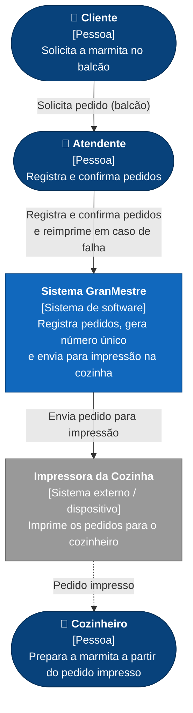
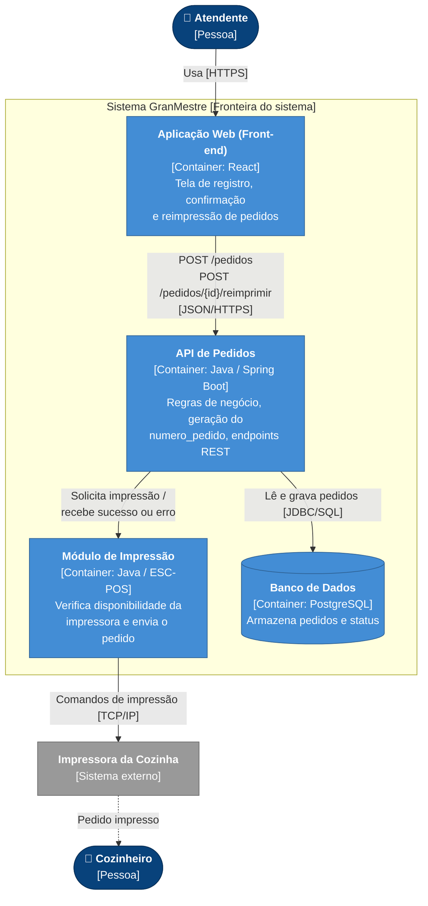

# Arquitetura

Esta página apresenta a arquitetura do Sistema GranMestre usando o **C4 Model**, nos níveis 1 (Contexto) e 2 (Containers).

## Nível 1: Diagrama de Contexto

Mostra o sistema no centro, as pessoas que interagem com ele e os sistemas externos.

**Legenda:** azul escuro = pessoas (atores); azul = sistema em construção; cinza = sistema/dispositivo externo.

| Elemento | Tipo | Descrição |
|---|---|---|
| Cliente | Pessoa | Pede a marmita no balcão e retira o pedido pronto |
| Atendente | Pessoa | Registra o pedido (tipo, acompanhamentos, observação), confirma e reimprime se necessário |
| Cozinheiro | Pessoa | Recebe o pedido impresso e prepara a marmita |
| Sistema GranMestre | Sistema | Núcleo da solução, objeto desta documentação |
| Impressora da Cozinha | Sistema externo | Dispositivo que imprime o pedido, evitando que a cozinha dependa de computador ou tela |

## Nível 2: Diagrama de Containers

Detalha as partes fundamentais do sistema e as tecnologias de cada uma.

| Container | Tecnologia | Responsabilidade |
|---|---|---|
| Aplicação Web | React | Interface do atendente: registrar pedido, confirmar, ver erros e reimprimir |
| API de Pedidos | Java / Spring Boot (REST) | Valida o pedido, gera `numero_pedido`, persiste e orquestra a impressão |
| Módulo de Impressão | Java / ESC-POS | Verifica a disponibilidade da impressora e envia o pedido; retorna erro sem excluir o pedido |
| Banco de Dados | PostgreSQL | Mantém todos os pedidos salvos, inclusive os que falharam na impressão |

!!! note "Decisões arquiteturais"
    - O pedido é **salvo antes da impressão**, então uma falha na impressora nunca causa perda de dados.
    - A cozinha recebe o pedido **impresso**, sem depender de computador ou tela (RN006).
    - A reimpressão manual retoma o fluxo a partir da etapa de impressão, sem recriar o pedido.
