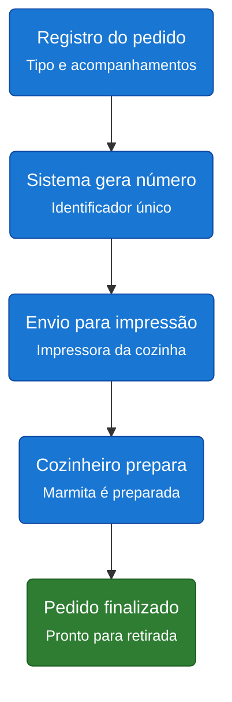
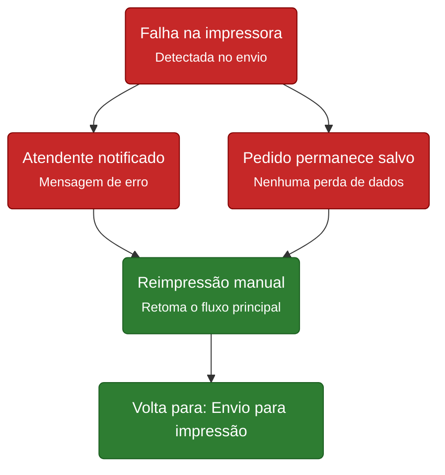

# Regras e Fluxos

**Projeto:** Sistema GranMestre Restaurante  
**Área documentada:** Fluxo de registro, impressão e preparo de pedidos  
**Categoria:** 02_Arquitetura_SAD (Visões Arquiteturais, Padrões e Componentes)

## Introdução

Atualmente, os pedidos de marmita no restaurante são feitos manualmente no balcão e levados até a cozinha sem registro digital, o que gera atraso e risco de erro na comunicação. Esta página documenta o fluxo completo do Sistema GranMestre, desde o registro do pedido pelo atendente até a marmita estar pronta para retirada.

## Personas envolvidas

| Persona | Papel |
|---|---|
| **Cliente** | Solicita a marmita no balcão |
| **Atendente** | Registra o pedido no sistema e o confirma |
| **Cozinheiro** | Recebe o pedido impresso na cozinha e prepara a marmita |

## Fluxo principal

1. O cliente solicita a marmita no balcão.
2. O atendente registra o pedido, selecionando tipo, acompanhamentos e observação (se necessário).
3. O atendente confirma o pedido.
4. O sistema gera um número de identificação único para o pedido.
5. O sistema verifica a disponibilidade da impressora da cozinha.
6. O pedido é enviado automaticamente para impressão na cozinha.
7. O cozinheiro recebe o pedido impresso e prepara a marmita.
8. O pedido é finalizado e fica pronto para retirada pelo cliente.

**Notação:** fluxograma de atividades. Retângulos arredondados são etapas, setas indicam a sequência. Azul: etapas do fluxo principal. Verde: conclusão bem-sucedida.

## Fluxo alternativo: falha na impressão

Se a impressora da cozinha estiver indisponível, o sistema:

- **Não descarta o pedido**, que permanece salvo no banco de dados;
- **Notifica o atendente** sobre a falha;
- **Aguarda a reimpressão manual**, que retoma o fluxo principal a partir da etapa de impressão.

**Notação:** vermelho indica fluxo alternativo (tratamento de exceção/erro); verde indica retomada bem-sucedida do fluxo.

## Regras de negócio relacionadas

| Código | Regra |
|---|---|
| **RN001** | Todo pedido confirmado deve ser encaminhado à cozinha |
| **RN006** | A cozinha não depende de computador ou tela para receber pedidos |

O fluxo alternativo garante conformidade com **RN001** (o pedido não é perdido e é reencaminhado na reimpressão) e **RN006** (a cozinha recebe tudo em papel).

## Tabela técnica

| Etapa do fluxo | Endpoint / Componente técnico |
|---|---|
| Registro do pedido | `POST /pedidos` |
| Sistema gera número | Campo `numero_pedido`, gerado automaticamente |
| Envio para impressão | Módulo de impressão (verificação de disponibilidade + envio) |
| Falha na impressora | Retorno de erro ao front-end, sem exclusão do pedido |
| Reimpressão manual | `POST /pedidos/{id}/reimprimir` |

**Tags:** `#arquitetura` `#fluxo-de-sistema` `#pedidos` `#impressao` `#api` `#regra-de-negocio` `#sistema-granmestre`
